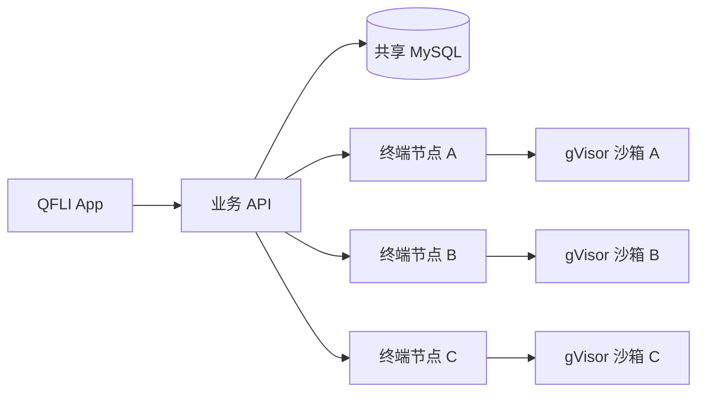

# 多节点扩展设计

终端节点池负责分配编译任务。
业务容器与终端容器独立部署。
终端故障不触发业务容器重启。



## 终端节点池

每台 2C2G 节点保留一个执行槽位。
增加节点可以增加总并发。
每台节点使用独立密钥。
业务容器不挂载 Docker socket。

业务端通过 `QFLI_TERMINAL_NODES` 配置节点。
以下配置中的地址和密钥均为示例。

```dotenv
QFLI_TERMINAL_NODES=[{"id":"node-a","url":"https://terminal-a.example.com","secret":"replace-with-node-a-secret-at-least-32-chars"},{"id":"node-b","url":"https://terminal-b.example.com","secret":"replace-with-node-b-secret-at-least-32-chars"}]
```

远程节点使用内部 HTTPS 入口。
防火墙只允许业务服务器访问该入口。
原有单节点配置继续生效。
迁移完成后可移除原有单节点配置。

调度器先检查节点健康状态。
新用户优先使用空闲节点。
后续命令保持原节点归属。
同一用户不能同时使用多个执行槽位。
全部槽位使用时，接口返回容量不足。

共享数据库存储槽位和操作令牌。
事务锁保护跨业务实例的分配。
调度器使用数据库时间判断租约。
请求超时不会证明旧命令已经停止。
未知结果会保留原节点归属。
确认原节点清理后，才能重新分配。
调度器不会自动重放失败的命令。

节点配置支持 `"draining":true`。
该状态停止接纳新用户。
已有用户仍保留原节点归属。
升级前先配置排空状态。
等待活动任务结束后再更新镜像。
自动替换执行器可能中断活动命令。
更新范围不得覆盖业务容器。

## 业务实例扩展

第一阶段保留一个业务实例。
多个终端节点承担编译负载。
该阶段不要求业务实例之间共享临时状态。

第二阶段增加业务实例。
反向代理分配业务请求。
所有实例使用同一个 MySQL 数据库。
所有实例使用相同的会话加密密钥。

当前业务仍有以下进程内状态。

| 状态 | 当前所有者 | 扩展前的工作 |
| --- | --- | --- |
| OAuth 临时请求 | `src/routes/auth.js` | 共享 TTL 存储和单次消费 |
| 华为登录及 MFA 请求 | `src/routes/auth.js` | 共享请求状态和原子消费 |
| 令牌刷新合并 | `src/identity.js` | 跨实例刷新锁和版本检查 |
| 终端及 AI 限流 | `src/audit.js`、`src/ai-client.js` | 共享计数或入口统一限流 |
| 云项目文件 | `src/cloud-storage.js` | 共享文件服务和原子写入 |
| SQL 执行环境 | `src/sqlbox.js` | 独立节点池和会话路由 |

当前版本不能直接宣称业务高可用。
仅增加业务副本不能补齐这些状态。
粘性路由可作为临时兼容方案。
它不能恢复已故障实例的临时状态。
不要让多个业务实例共享网络 SQLite 文件。

第三阶段拆分存储和执行服务。
按实测负载选择拆分顺序。
数据库迁移由单个发布任务执行。
滚动升级期间保留旧版本所需字段。
业务健康检查不依赖所有终端节点正常。

## 镜像与更新

CI 构建业务镜像和终端镜像。
CI 同时构建沙箱工具链镜像。
服务器只拉取已经构建的镜像。
业务与终端使用独立更新范围。
回滚时使用旧镜像的不可变标识。
仅恢复 `latest` 标签不能保证回滚。

## 验证边界

SQLite 测试只能证明对应驱动的行为。
多业务实例上线前须验证 MySQL 并发。
部署前须验证实际 UID 和 cgroup 限额。
静态 YAML 检查不能替代容器执行验证。
